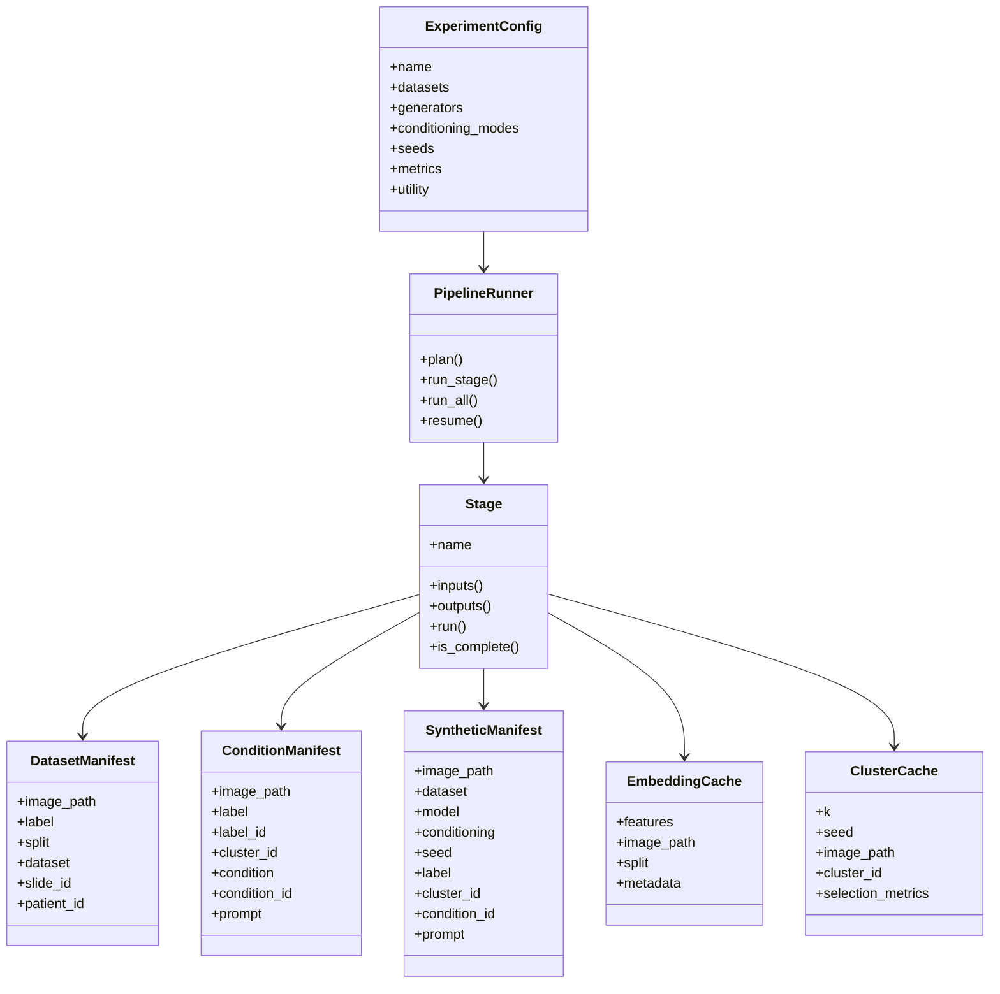
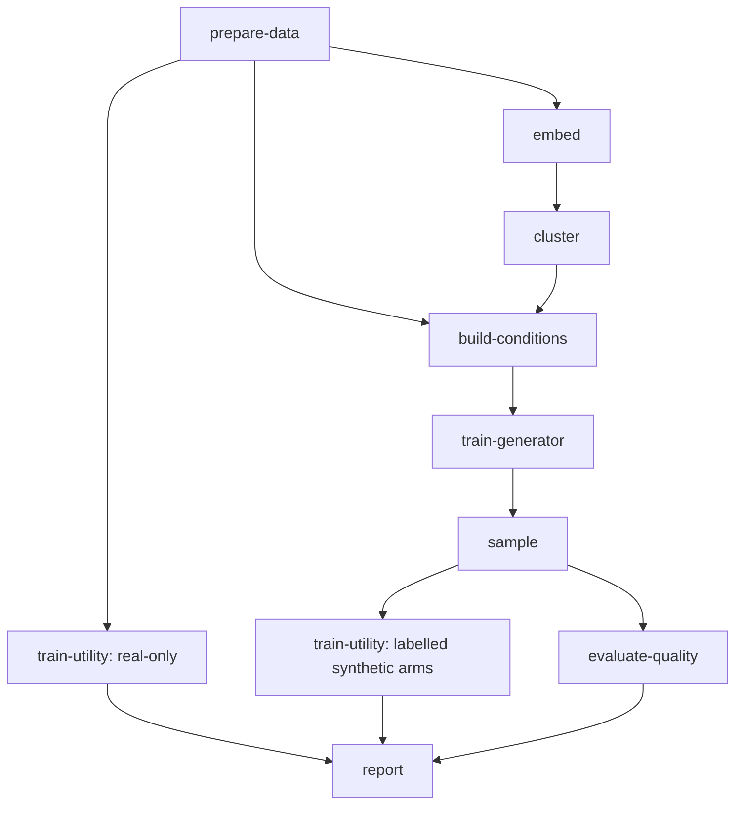
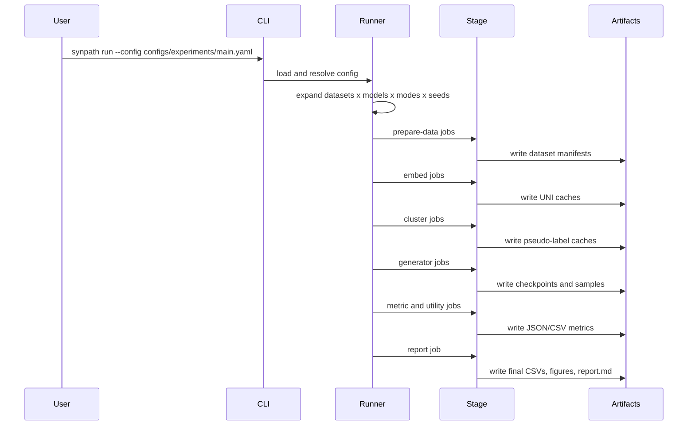

# Pipeline design

This document describes the implementation shape for `synpath`. The goal is a
simple, file-based pipeline where every stage can run independently, but the
whole experiment can also run end-to-end on a DGX without manual intervention.

## Design principles

- Keep stages separate and boring.
- Pass data between stages through manifests and artifact files.
- Make every stage re-entrant: if expected outputs exist and match the resolved
  config, the stage can skip or resume.
- Keep external model code outside `src/synpath`.
- Make the CLI the primary interface.
- Use YAML configs to define datasets, models, metrics, and study arms.
- Produce final CSVs, figures, and a short Markdown report from the same
  artifacts used for audit.

## Main objects



## Stage graph



The full pipeline runs this graph for every configured dataset, generator,
conditioning mode, and seed.

## Stages

### `prepare-data`

Input:

- dataset config
- raw dataset location or downloader config

Output:

```text
{DATA_ROOT}/manifests/{dataset}.csv
```

Responsibilities:

- download or locate raw data
- create train/validation/test splits
- convert labels to stable names and integer IDs
- write the common dataset manifest

### `embed`

Input:

- dataset manifest
- encoder config, initially UNI

Output:

```text
{CACHE_ROOT}/embeddings/{dataset}/{split}_uni_224.parquet
```

Responsibilities:

- load images from the manifest
- run UNI over train/validation/test splits
- cache embeddings and metadata
- record source manifest hash

### `cluster`

Input:

- train split UNI embeddings
- clustering config

Output:

```text
{CACHE_ROOT}/clusters/{dataset}/selected_global_k.yaml
{CACHE_ROOT}/clusters/{dataset}/pseudo_labels.csv
{CACHE_ROOT}/clusters/{dataset}/label_local_cluster_labels.csv
```

Responsibilities:

- run global KMeans for pseudo-label mode
- reuse global KMeans for label-plus-global-cluster mode
- run within-class KMeans for label-plus-local-cluster mode
- score candidate `k` values
- write selected cluster assignments

### `build-conditions`

Input:

- dataset manifest
- pseudo-label cache
- label-plus-local-cluster cache
- model config
- conditioning mode

Output:

```text
{OUTPUTS_ROOT}/conditions/{dataset}/{conditioning}/condition_manifest.csv
```

Responsibilities:

- create one conditioning table per dataset and conditioning mode
- compile class labels, pseudo-labels, or class-plus-cluster labels into
  stable integer condition IDs
- create Stable Diffusion prompts
- create StyleGAN2-ADA labels

### `train-generator`

Input:

- condition manifest
- model config
- experiment arm config

Output:

```text
{OUTPUTS_ROOT}/generators/{dataset}/{model}/{conditioning}/seed{seed}/
    resolved_config.yaml
    checkpoints/
    logs/
```

Responsibilities:

- dispatch to the correct external training backend
- train StyleGAN2-ADA or fine-tune Stable Diffusion LoRA
- save resolved config and logs

### `sample`

Input:

- trained generator checkpoint
- condition manifest
- sampling config

Output:

```text
{OUTPUTS_ROOT}/generators/{dataset}/{model}/{conditioning}/seed{seed}/
    samples/
    synthetic_manifest.csv
```

Responsibilities:

- generate PNG samples
- preserve the relevant real distribution:
  - `P(class)` for true-label mode
  - no label distribution for unconditioned mode
  - `P(cluster)` for pseudo-label mode
  - `P(class, global cluster)` for label-plus-global-cluster mode
  - `P(class, local cluster)` for label-plus-local-cluster mode
- write a complete synthetic manifest

### `evaluate-quality`

Input:

- real dataset manifest
- synthetic manifest
- cached UNI embeddings
- metric config

Output:

```text
{OUTPUTS_ROOT}/generators/{dataset}/{model}/{conditioning}/seed{seed}/metrics/
    sampled_real.csv
    sampled_synthetic.csv
    inception_fid.json
    uni_fid_kid.json
    uni_precision_recall.json
    uni_cluster_coverage.json
    privacy_nearest_neighbor.json
```

Responsibilities:

- perform capped reproducible metric sampling
- compute Inception-FID
- compute UNI-FID or UNI-KID
- compute UNI precision/recall
- compute cluster coverage
- compute nearest-neighbor privacy audit

### `train-utility`

Input:

- dataset manifest
- synthetic manifest for labelled arms, where relevant
- ResNet-18 config

Output:

```text
{OUTPUTS_ROOT}/utility/{dataset}/resnet18/{source}/seed{seed}/
    resolved_config.yaml
    metrics.json
    classification_report.json
    confusion_matrix.csv
    predictions.csv
```

Responsibilities:

- train ImageNet-pretrained ResNet-18 classifiers
- evaluate only on the real test split
- run only for labelled sources:
  - real only
  - true-label synthetic only
  - real plus true-label synthetic
  - label-plus-global-cluster synthetic only
  - real plus label-plus-global-cluster synthetic
  - label-plus-local-cluster synthetic only
  - real plus label-plus-local-cluster synthetic

### `report`

Input:

- quality metric JSON files
- utility metric JSON files
- experiment config

Output:

```text
{REPORTS_ROOT}/{experiment}/
    results.csv
    quality_metrics.csv
    utility_metrics.csv
    figures/
    report.md
```

Responsibilities:

- aggregate all completed arms
- write tidy CSVs
- create summary figures
- produce a short Markdown report

## Orchestration

The orchestration layer should remain small. It resolves a study config into
concrete stage jobs, checks whether each job is complete, and runs missing jobs
in dependency order.



## CLI commands

The CLI exposes both granular and end-to-end commands.

Granular:

```bash
synpath prepare-data --dataset pathmnist224
synpath embed --dataset pathmnist224 --encoder uni
synpath cluster --dataset pathmnist224
synpath build-conditions --dataset pathmnist224 --conditioning label_local_cluster
synpath train-generator --dataset pathmnist224 --model sd_lora --conditioning label_local_cluster
synpath sample --dataset pathmnist224 --model sd_lora --conditioning label_local_cluster
synpath evaluate-quality --dataset pathmnist224 --model sd_lora --conditioning label_local_cluster
synpath train-utility --dataset pathmnist224 --source real_plus_synthetic_label_local_cluster
synpath report --config configs/experiments/main.yaml
```

End-to-end:

```bash
synpath run --config configs/experiments/main.yaml
```

Dry run:

```bash
synpath plan --config configs/experiments/main.yaml
```

Smoke test:

```bash
synpath run --config configs/experiments/smoke.yaml
```

## Job expansion

For the main study, the runner expands:

```text
datasets x generators x conditioning_modes x generator_seeds
```

Quality metrics run for every generated arm.

Utility runs for labelled arms only:

- `true_label`
- `label_global_cluster`
- `label_local_cluster`

Utility does not run for:

- `unconditioned`
- `pseudo_label`

## Completion checks

Each stage should define expected outputs:

```python
class Stage(Protocol):
    name: str

    def outputs(self) -> list[Path]:
        ...

    def run(self) -> None:
        ...

    def is_complete(self) -> bool:
        return all(path.exists() for path in self.outputs())
```

When `--resume` is enabled, complete jobs are skipped.

## Failure behavior

- Fail early when a required manifest, checkpoint, or cache file is missing.
- Write logs per arm.
- Do not silently continue if an upstream stage failed.
- Keep partially complete arms isolated in their own output directories.

## Minimal implementation order

1. Manifest schema and `prepare-data`.
2. Runner/job model with `plan` and `run`.
3. `build-conditions`.
4. UNI embedding cache.
5. KMeans clustering.
6. ResNet-18 utility path.
7. Quality metric path.
8. StyleGAN2-ADA wrapper.
9. Stable Diffusion LoRA wrapper.
10. Report aggregation.

This order gives us useful end-to-end tests before the heaviest generator code
lands.
